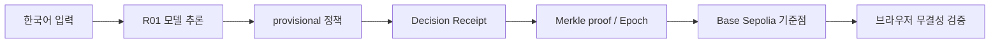

# VeriMod

**User-Verifiable AI Moderation Protocol**

사용자가 AI 판정 기록의 무결성을 직접 확인할 수 있도록 돕는 프로토콜

팀 **HTTP 451** · BLOCK AI 2026 트랙 1 · **Decide. Prove. Appeal.**

[](https://github.com/jujinho03/verimod/actions/workflows/ci.yml?query=branch%3Amain)

> **문서 기준:** 2026-10-31 확인 main `f6ad522513dcb198d520c70f98c1cc5e98748f51`. 구현과 실행 결과는 서로 다른 근거입니다. GitHub의 최신 SHA·CI와 발표 세션의 실제 결과를 별도로 확인하세요.
>
> **멘토링 자료:** [5회차 기술 요약과 질문](docs/mentoring/mentor-brief-20261031.md) · [1~4회차 권고 추적](docs/mentoring/README.md) · [전체 문서 안내](docs/README.md)

## 문제와 접근

플랫폼이 AI 판정으로 콘텐츠를 제한할 때 사용자는 판정의 이유와 이후 기록이 바뀌지 않았는지 확인하기 어렵습니다. VeriMod는 판정에 대한 **Decision Receipt**를 발급하고, 그 해시의 Merkle 포함 증명과 공개된 Epoch 기준점을 대조해 발급 후 기록 무결성을 검증합니다.

| 역할 | 담당하는 일 | 보장하지 않는 일 |
| --- | --- | --- |
| AI 및 정책 | R01 모델이 한국어 콘텐츠를 분류하고 점수를 제공합니다. 별도 정책 계층이 조치를 결정합니다. | AI 판정의 정답성·공정성이나 보정된 확률을 보장하지 않습니다. |
| Receipt·블록체인 | Receipt commitment와 Merkle root를 이용해 발급된 기록의 사후 무결성을 대조합니다. | 실제 특정 모델 실행, 최초 발급자의 정직성, 전체 기록의 완전성 또는 L1 finality를 증명하지 않습니다. |
| 사용자 화면 | 판정·Receipt·검증과 합성 이의제기 흐름을 보여줍니다. | 합성 Appeal/Review는 실제 운영 이의제기 백엔드가 아닙니다. |

원문·salt·개인정보는 온체인에 올리지 않습니다.

## 시스템 구성



이 도식은 구성 요소 간 관계를 나타냅니다. **W7의 신규 R01 추론·발급과 과거 W4 Epoch 1 검증은 별개 사례**입니다. 신규 Receipt가 W4 앵커에 포함된 하나의 새로운 전체 거래라고 주장하지 않습니다.

## 구현 및 검증 현황

| 범위 | 확인된 내용 | 한계 |
| --- | --- | --- |
| W4 공개 실증 | 2026-10-20 Base Sepolia Epoch 1에 실제 Receipt 2건을 고정했습니다. W4 GATE-4는 기술 조건 14/14 PASS입니다. | [공개 증거](docs/handoffs/w4-anchored-epoch-public/20261020-r01/README.md)는 과거 실행이며 새 W7 거래가 아닙니다. |
| W7 LIVE 발급 | R01 → Node Backend → 신규 Receipt의 별도 로컬 실행에서 HTTP 201, `PENDING_ANCHOR`가 보고됐습니다. 모델 중단 시 503·미발급과 재기동 후 복구도 확인했습니다. [PR #42 실행 요약](https://github.com/jujinho03/verimod/pull/42) | 신규 Receipt의 proof와 anchor는 null입니다. 매 발표 환경의 재현은 별도 확인이 필요합니다. |
| AI 평가 | BEEP! Korean HateSpeech의 VALIDATION 1,255건에서 R01 Macro-F1 약 0.6525를 기록했습니다. [Data Card](docs/data-card.md) · [Model Card](docs/model-card.md) | 점수는 `UNCALIBRATED`, TEST는 `SEALED`입니다. VALIDATION 결과를 TEST 성능이나 정책 안전성으로 해석하지 않습니다. |
| GitHub 통합 | [PR #41](https://github.com/jujinho03/verimod/pull/41) 데모 개선과 [PR #42](https://github.com/jujinho03/verimod/pull/42) Backend 의존성 패치가 기준 main에 포함됐습니다. [기준 main CI](https://github.com/jujinho03/verimod/actions/runs/41178415036) 3개 job 성공. | CI 성공은 현장 LIVE RPC, 전체 리허설 또는 운영 안전성 보장이 아닙니다. |

W5 GATE-5와 원래 W6 Engineering Exit는 `PARTIAL`입니다. W6은 수용된 위험을 동반해 조건부 종료됐으며, W7의 발표 범위는 승인된 [Option B 결정](docs/evidence/w6-w7-core-demo-scope-proposal-20261030.md)을 따릅니다.

## W4 Base Sepolia 공개 증거

| 항목 | 값 |
| --- | --- |
| 네트워크 | Base Sepolia · chain ID `84532` · Epoch 1 |
| Transaction | [`0x175b3c1a…b5cc67286`](https://sepolia.basescan.org/tx/0x175b3c1ad237a087984b17b47c0343fedfd314a5eb1c34ba7a22511b5cc67286) |
| 공개 자료 | [Receipt·proof·anchor와 당시 검증 기록](docs/handoffs/w4-anchored-epoch-public/20261020-r01/README.md) |
| 증거 tree | `1911f46c9e19000d25a7ffb5f86f1c2ba781a1ee` |

L2 확인 수와 L1 finality는 다릅니다. 공개 RPC 오류는 `RPC_UNAVAILABLE`로 표시하며 정상 또는 변조 결과로 바꾸지 않습니다.

## 데모 및 실행

기본 브라우저 Lifecycle은 **합성 점수·모의 원장**을 사용합니다. W4 공개 Receipt 검증은 승인된 Base Sepolia profile과 읽기 전용 RPC를 사용하는 별도 경로입니다. R01 실제 추론은 고정된 로컬 가중치·tokenizer와 서비스 준비가 필요하며 clone만으로 제공되지 않습니다.

```sh
git clone https://github.com/jujinho03/verimod.git
cd verimod/frontend
npm ci
npm run dev
```

로컬 주소에서 화면을 확인합니다. W4 공개 샘플 로딩, `HASH_MISMATCH`, rehash `INVALID_PROOF`, RPC 장애·복구 및 실제 R01 준비는 [심사위원용 실행 안내](docs/08-submission-guide.md)를 따릅니다. 합성 `VALID`는 공개 체인 성공이 아닙니다. 480초 리허설과 전체 녹화는 실제 수행·검증 후에만 완료로 표시합니다.

## 기술 스택과 역할

| 영역 | 주요 구성 | 담당 |
| --- | --- | --- |
| AI | Python · PyTorch · KLUE RoBERTa · FastAPI | A / 주진호 |
| 서비스 | Node.js · TypeScript · Express · SQLite | F / 노유신 |
| 프로토콜·체인 | TypeScript · Solidity · Hardhat · Base Sepolia | T / 설경민 |
| 사용자 화면 | React · Vite · 브라우저 검증기 | F / 노유신 |
| 공통 규칙 | [shared/protocol](shared/protocol/README.md)의 Receipt·hash·Merkle 구현 | A/F/T |

## 문서와 멘토링

| 목적 | 자료 |
| --- | --- |
| 현재 상태·승인 범위 | [현재 상태](docs/03-current-status.md) · [결정 기록](docs/02-decision-register.md) |
| 시스템·계약 | [프로토콜 명세](docs/spec/README.md) · [모듈 구성](docs/README.md) |
| 데이터·모델 | [Data Card](docs/data-card.md) · [Model Card](docs/model-card.md) |
| 실행·검증 | [증거 안내](docs/evidence/README.md) · [주차별 진행](docs/progress/README.md) |
| 멘토링 | [회차별 자료·추적](docs/mentoring/README.md) · [5회차 질문](docs/mentoring/mentor-brief-20261031.md) |
| 데모 | [실행 안내](docs/08-submission-guide.md) · [W7 인계](docs/handoffs/W7-core-demo-approved-handoff-20261030.md) |

## 남은 조건과 Post-MVP

- S1 연구 정책은 `PENDING_APPROVAL`, Model/Policy LOCK은 `NOT_EXECUTED`, TEST는 `SEALED`입니다.
- 기존 보고 기준 BASE 연속 10회 성공은 `NOT_MET`입니다. 실제 Hardhat LOCAL과 물리 모바일은 각각 `NOT_VERIFIED`, `NOT_EXECUTED`입니다.
- RPC backup 범위 제한, chain 확인과 데이터 요청 사이 TOCTOU, T 전문 보안 리뷰 및 개발 의존성 보안 후속이 남아 있습니다.
- CNU MATE 제출·접수는 `NOT_VERIFIED`입니다. 전체 480초 리허설과 녹화는 실제 결과 확인 전 완료로 기록하지 않습니다.
- 실제 Appeal/Review 운영 백엔드, 신규 연구 정책 적용, 새 Epoch와 외부 댓글 분석은 별도 결정·검증이 필요한 후속 범위입니다.

[기여 안내](CONTRIBUTING.md) · [전체 문서](docs/README.md) · [GitHub Actions](https://github.com/jujinho03/verimod/actions)
