# VeriMod

**사용자가 직접 검증하는 AI 모더레이션 프로토콜 · HTTP 451 · BLOCK AI 2026**

콘텐츠 판정의 공개 영수증(Decision Receipt), 해시, Merkle 포함 증명과 외부 앵커를 대조하여 기록의 무결성을 확인하고 이의제기 이력을 추적합니다.

[](https://github.com/jujinho03/verimod/actions/workflows/ci.yml?query=branch%3Amain)

## 3회차 멘토링: 먼저 읽을 자료

**갱신일: 2026-10-17 · W4 GATE-4: PARTIAL(부분 완료).**

실제 R01 모델 → Python API → Node 정책/발급 → SQLite 저장 → Receipt 2건의 Epoch Freeze까지 실행했습니다. 실제 Epoch 1의 Base Sepolia 송신, F의 온체인 확인, 외부 브라우저 검증은 아직 완료하지 않았습니다. 현재 차단사항은 A 호스트 관리자 UAC 접근과 A/T 사설 Callback 채널·승인 RPC 구성입니다.

- [3회차 멘토링 사전자료](docs/mentor-prep-session3.md): 성과·한계·확인받을 질문
- [W4 팀 통합 현황](docs/progress/W4.md): 담당별 결과와 남은 조건
- [실제 Frozen Epoch JSON 4개](docs/handoffs/w4-frozen-epoch-public/20261017-r01/README.md): 원본 SHA-256 포함
- [최소 운영 절차·승인 구분](docs/handoffs/W4-AFT-operations.md)
- [전체 문서 안내](docs/README.md)

## main과 작업 브랜치의 범위

**이번 main 갱신은 한국어 문서와 공개 증빙 반영입니다. W4 실행 코드를 통째로 병합한 릴리스가 아닙니다.** main 실행 코드는 W3 통합 기준이며, W4 구현은 아래 고정 소스에서 확인합니다. 구현 완료와 실제 호스트 연결 완료를 구별합니다.

| 영역 | 확인한 소스 | 범위 |
| --- | --- | --- |
| main 실행 코드 | `1401e03931f76ed8405454081adb9478339bae67` | W3 공동 통합: 실제 모델 출력 fixture, backend 발급, 공유 규격·계약 |
| A: AI·평가·연동 | [`3a8993b`](https://github.com/jujinho03/verimod/tree/3a8993bfaf36642d2a67d0a147da9086008bd912) | 실제 추론, VALIDATION 평가, 정책 비교/parity, A/F E2E |
| F: 서비스·검증 | [`c1f750e`](https://github.com/jujinho03/verimod/tree/c1f750ea3752037d749324f1535df051ce6b37f9) | HTTP adapter, Manifest 검증, SQLite Freeze·durable ACK·confirmation |
| T: 프로토콜·체인 | [`7534907`](https://github.com/jujinho03/verimod/tree/7534907fa3ad66cc6ed29cfbee2efd8c2c75369e) | Issuer·승인 프로필, F ACK 후 송신, SUBMITTED/CONFIRMED 분리 |

## 실제로 확인한 결과

| 항목 | 결과와 한계 |
| --- | --- |
| AI-09 실제 추론 | PASS. 선정 R01 가중치·고정 tokenizer로 실제 forward. UNCALIBRATED 점수 |
| AI-21 VALIDATION | PASS. 1,255건, Macro-F1 **0.6524599868976999**, Accuracy **0.6629482071713148**, W3와 동일 |
| 실제 A/F E2E | FULL/TRUNCATED 정상 2건, Fail Closed **17/17**, 정책 parity **21/21** PASS |
| 실제 발급·Freeze | Receipt 2건, Epoch 1, version 1, 독립 Merkle·SQLite 재개방 PASS |
| 최신 F 원본 DB status | PASS. FROZEN/tx_hash=null, DB bytes·identity·멤버 보존 |
| F confirmation 회귀 | F 보고 **192/192 PASS**. 합성 DB/RPC stub이며 실제 체인 검증 아님 |
| 실제 Epoch 송신·외부 브라우저 VALID | 미완료. GATE-4 전체 PASS로 계산하지 않음 |

실제 Frozen Epoch root:

```text
0x32bf54ab91c8727e476bd4aaa13dacc6af4eaa8273656317ce7f331e29a29f82
```

[실행 근거와 수치 해설](docs/evidence/w4-a-actual-frozen-epoch.md) · [F 검사 범위](docs/evidence/w4-f-confirmation/20261017/README.md)

## 동작 경로와 현재 경계

```mermaid
flowchart LR
  Text[합성 한국어 입력] --> Model[실제 R01 Python 추론]
  Model --> Policy[Node 시험용 정책]
  Policy --> Receipt[영수증 발급과 SQLite]
  Receipt --> Freeze[실제 Epoch 1 Freeze 완료]
  Freeze --> Gate[사설 채널과 durable ACK 준비 중]
  Gate --> Sender[T 노트북 signer 실행 대기]
  Sender --> Chain[실제 Epoch 송신 미실행]
  Chain --> Confirm[F 독립 confirmation 미실행]
  Confirm --> Browser[외부 브라우저 검증 미완료]
```



Native label은 `hate / offensive / none`, 외부 score key는 `hate / offensive`입니다. `none`은 ALLOW와 동의어가 아니며 정책은 Node가 결정합니다. 정책은 **W4_PROVISIONAL_E2E_ONLY, team_approved=false**이고 운영 승인/LOCK은 없습니다. TEST는 계속 SEALED입니다.

## main의 기존 데모 실행

main의 기존 브라우저 데모는 합성 점수·모의 원장 경로입니다. 이를 실제 R01/공개 체인 실행으로 소개하지 않습니다. 모델 가중치와 private DB는 저장소에 없어 clone만으로 A 호스트의 실제 환경이 구성되지 않습니다.

```sh
git clone https://github.com/jujinho03/verimod.git
cd verimod/frontend
npm ci
npm run dev
```

터미널의 localhost 주소를 엽니다. [기존 데모 안내](docs/08-submission-guide.md)와 [실제 W4 연결](docs/handoffs/W4-AFT-operations.md)을 구별합니다.

## 구성과 담당

| 경로 | 담당·책임 |
| --- | --- |
| [ai/](ai/README.md) | A / 주진호: 데이터·모델·추론·평가·정책 후보 근거 |
| [backend/](backend/README.md) | F / 노유신: API·정책·SQLite·발급·검증 |
| [backend/contracts/](backend/contracts/README.md) | T / 설경민: 프로토콜·계약·배포·송신 |
| [frontend/](frontend/) | F 서비스 UI, T 승인 프로필/RPC 검증 경계 |
| [shared/protocol/](shared/protocol/) | canonical bytes·hash·Receipt·Merkle 공유 규칙 |
| [docs/](docs/README.md) | 공동 결정·주차별 기록·증빙·멘토링 |

main 전체 회귀 명령은 `node scripts/check-all.mjs`이며 Python 검사는 [AI 안내](ai/README.md)를 따릅니다. 이번 문서 갱신은 링크·소스 범위·JSON 해시·개인정보 노출을 검사하며 과거 모델/DB 검증을 재실행한 것으로 기록하지 않습니다.

## 신뢰와 공개 범위

- 원문·salt·private package·서명키·DB 경로는 공개 Bundle에 넣지 않습니다.
- 실제 두 Bundle의 proof/anchor는 null입니다. F 확인 전 공개 체인 VALID를 주장하지 않습니다.
- 해시/Merkle/앵커는 AI 정확성·공정성·실제 모델 실행·전체 기록의 완전성을 증명하지 않습니다.
- W3 원본과 과거 실패 증거는 보존하고 한국어 해설에서 연결합니다.
- W5 이후 작업, TEST 개봉, 재학습, 정책 LOCK은 이번 범위가 아닙니다.
